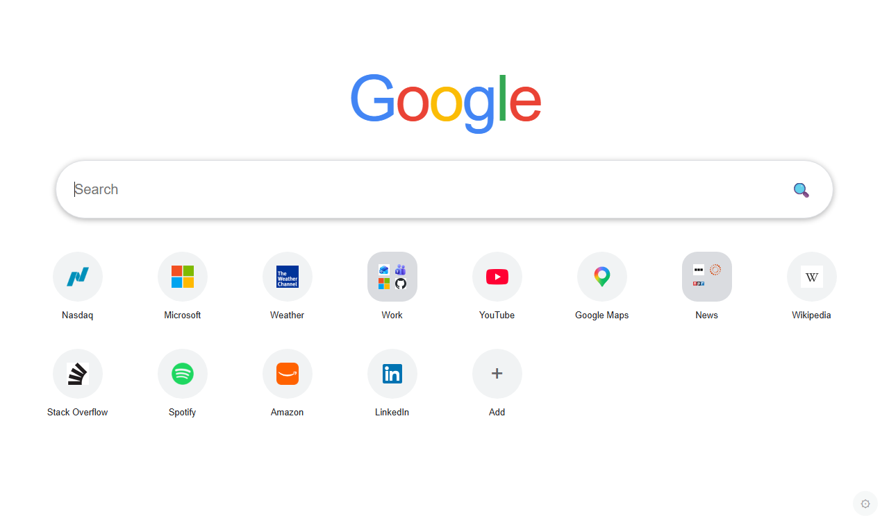
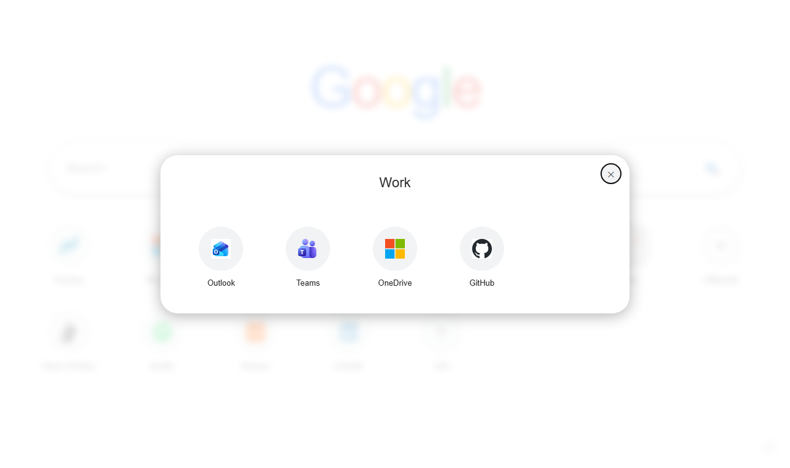

# MyNewPage

Your own new tab page: Google search on top, your favorite sites below it in as many rows and folders as you like, synced through your own Google Drive. It comes as a **Chrome extension** (replaces the new tab page) and as a **web version** you can use as the homepage on your phone.

**Website:** <https://mynewpage.as.hu> · **Web version:** <https://mynewpage.as.hu/myhome/index.html> · **Privacy policy:** <https://mynewpage.as.hu/privacy.html> · **Source:** <https://github.com/Meister1977/MyNewPage>

Both the Chrome extension and the web version are open source and live in this repository.



## Features

- **Favorites in multiple rows**, editable (name and address) at any time.
- **Folders, like on an iPad:** drag one favorite onto another to create a folder; drag more in, drag them out, rename or delete it. A folder with a single item left dissolves automatically.
- **Drag and drop ordering**, plus a context menu (right click or long press) with move earlier / later for keyboard and touch use.
- **Add the current page in one click** with the extension's toolbar button.
- **Synced through Google Drive:** favorites are stored in the hidden app data folder of your own Drive. The developer never sees your data.
- **Use it on your phone:** set the web version as the Chrome homepage. The settings dialog shows a QR code for the address.
- **33 languages**, following the browser language by default and selectable in the settings. English is the fallback.
- **Light and dark mode**, following the system theme.
- **Your default search engine** in the extension (the web version uses Google).



## Install

### Chrome extension

The extension is not on the Chrome Web Store yet. To try it:

1. Build it (see [Build](#build)).
2. Open `chrome://extensions`, turn on **Developer mode**, choose **Load unpacked** and select `dist/extension`.
3. Open a new tab and sign in with Google to start syncing. Without signing in, favorites are kept only in the browser.

### Web version (phone)

Open <https://mynewpage.as.hu/myhome/index.html>, sign in with Google, then in Chrome on your phone go to **Settings → Homepage** and enter that address.

## Privacy

MyNewPage has no server of its own. Your favorites and language setting are stored in your browser and, if you sign in, in a single file (`favorites.json`) in your Google Drive `appDataFolder`. The only Google permission requested is `drive.appdata`. There are no ads, analytics or tracking. See the full [privacy policy](site/privacy.html).

## Project structure

| Path | Contents |
|---|---|
| `shared/` | Code shared by both targets: `app.js` (UI), `store.js` (data model and sync), `drive.js` (Drive API), `i18n.js`, `page.html`, CSS, `_locales/`, icons |
| `platform/extension/` | `manifest.json`, `background.js` (add current tab), `platform.js` (`chrome.identity`, `chrome.storage`) |
| `platform/web/` | `platform.js` (Google Identity Services, `localStorage`) |
| `site/` | The static description and privacy pages served at the site root |
| `vendor/` | [`qrcode-generator`](https://github.com/kazuhikoarase/qrcode-generator) (MIT), used for the QR code |
| `build.ps1` | Builds `dist/extension` and `dist/web` |

How sync works: every change is saved to a local cache immediately and pushed to Drive about 0.6 seconds later. On conflict, the most recently modified copy wins (`updatedAt`). The page pulls again when it becomes visible (at most every 20 seconds).

## Build

Requires PowerShell. No other dependencies.

```powershell
powershell -File build.ps1
```

Output:

- `dist/extension`: the Chrome extension.
- `dist/web`: the site root (`index.html`, `privacy.html`, `assets/`) and `dist/web/myhome/`, the web version.

## Running your own copy

The Google sign-in needs OAuth clients from your own Google Cloud project:

1. Create a project and enable the **Google Drive API**.
2. Configure the OAuth consent screen with the scope `https://www.googleapis.com/auth/drive.appdata`.
3. Create a **Web application** client with your site origin as an authorized JavaScript origin, and put its client ID in `shared/config.js` (`WEB_CLIENT_ID`; also set `SITE_URL`).
4. Create a **Chrome extension** client for your extension ID and put its client ID in `platform/extension/manifest.json` (`oauth2.client_id`).
   To keep a stable extension ID during development, add your own `key` to the manifest. Never commit the matching private key (`*.pem` is git-ignored).
5. While the consent screen is in *Testing* mode, only the test users you add can sign in.

## Author

Developed by **Ambrózy Lőrinc**. Contact details are on the [website](https://mynewpage.as.hu).

Google, Google Drive and Chrome are trademarks of Google LLC. MyNewPage is an independent project and is not affiliated with or endorsed by Google.
